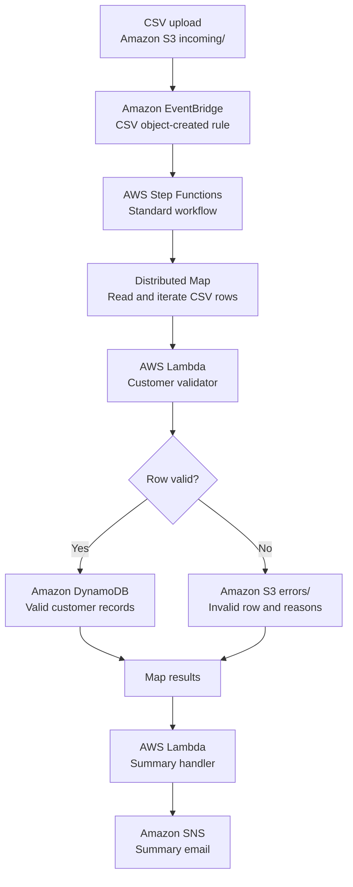
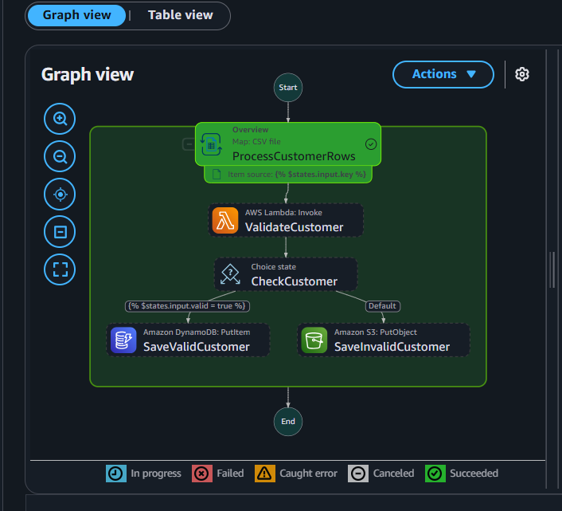
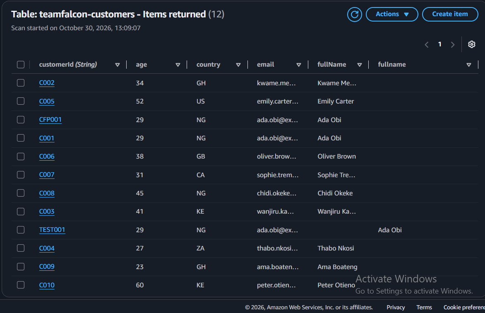
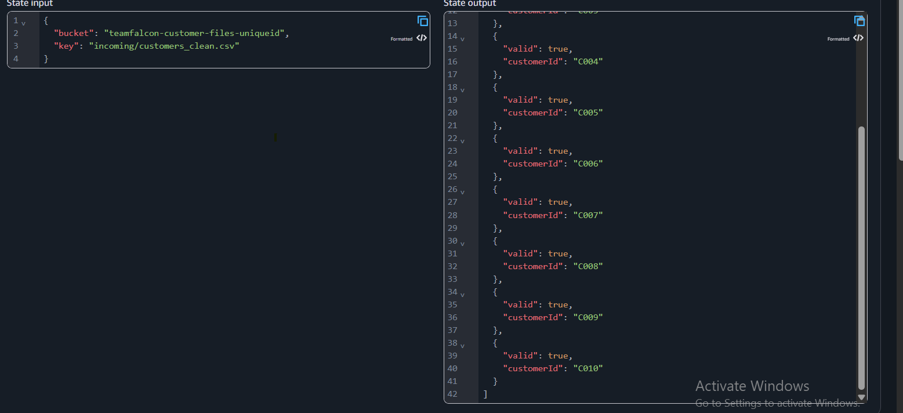
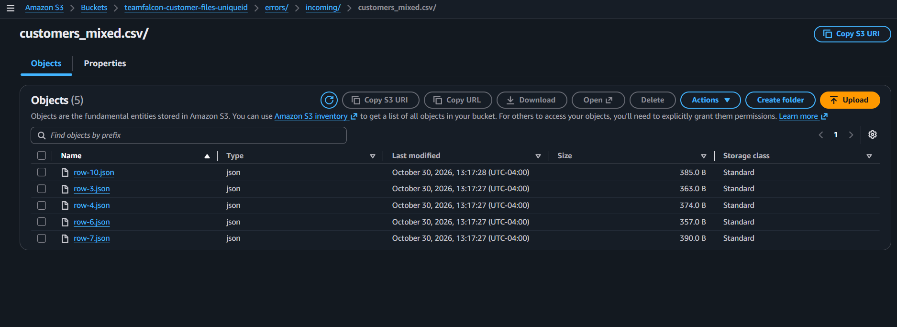
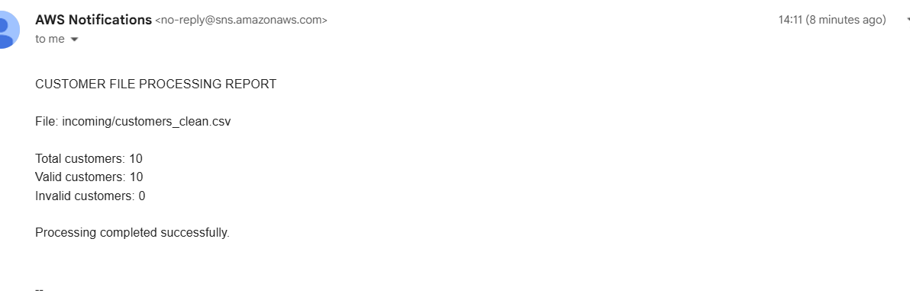
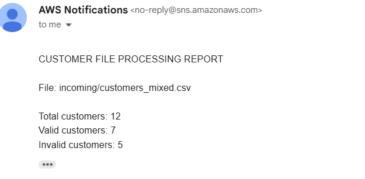
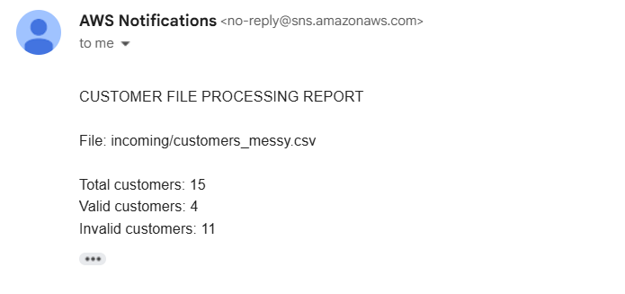

# Customer File Processor

A serverless AWS workflow that automatically processes customer CSV uploads, validates every row, stores valid customers in DynamoDB, writes invalid rows and all validation reasons to S3, and emails a processing summary through SNS.

## Verified implementation

Region: `us-east-1` (US East, N. Virginia)

| Test file | Total | Valid | Invalid | Result |
|---|---:|---:|---:|---|
| `customers_clean.csv` | 10 | 10 | 0 | Passed |
| `customers_mixed.csv` | 12 | 7 | 5 | Passed |
| `customers_messy.csv` | 15 | 4 | 11 | Passed |

An additional automatic-trigger test confirmed that uploading a new `customers_clean.csv` object under `incoming/` started Step Functions and returned 10 total, 10 valid, 0 invalid.

## Architecture

The workflow is event-driven and serverless. Uploading a CSV to the S3 `incoming/` prefix starts the state machine automatically. A Distributed Map processes each CSV row independently, then routes valid and invalid records to their respective destinations.



The editable Mermaid source is also available at [`architecture/architecture.mmd`](architecture/architecture.mmd).

### Processing sequence

1. A CSV file is uploaded to S3 `incoming/`.
2. S3 sends the object-created event to EventBridge.
3. EventBridge filters for CSV files in `incoming/` and starts the Step Functions workflow with the bucket and key.
4. Step Functions uses a Distributed Map to read and process each CSV row.
5. The validator Lambda applies all five validation rules and returns every failure reason.
6. Valid records are stored in DynamoDB; invalid records are saved as JSON in S3 `errors/`.
7. The summary Lambda calculates totals and publishes the report through SNS.

## Implementation screenshots

The screenshots below provide evidence from the deployed AWS workflow and its test runs. They show the workflow configuration, persisted valid records, invalid-row handling, and the email summaries produced by SNS.

### Step Functions workflow



### Valid customer records in DynamoDB



### Clean-file processing results



### Invalid records written to S3



### SNS processing summary emails

| Clean file — 10 valid, 0 invalid | Mixed file — 7 valid, 5 invalid | Messy file — 4 valid, 11 invalid |
|---|---|---|
|  |  |  |

Additional evidence, including the validator test and EventBridge configuration, is available in [`docs/screenshots/`](docs/screenshots/). See [`docs/test-results.md`](docs/test-results.md) for the complete test matrix.

## Validation rules

A row is valid only if:
1. `customerId` is not empty.
2. `fullName` is not empty.
3. `email` contains one `@`, text before and after it, and a dot with text around it after the `@`.
4. `age` is a whole number from 18 through 100 inclusive.
5. `country` is exactly one of `NG`, `GH`, `KE`, `ZA`, `US`, `GB`, `CA`.

All failure reasons are collected; validation does not stop at the first failure.

## AWS resources used

| Resource | Name |
|---|---|
| S3 bucket | `teamfalcon-customer-files-uniqueid` |
| S3 prefixes | `incoming/`, `errors/` |
| DynamoDB table | `teamfalcon-customers` |
| Partition key | `customerId` (String) |
| Validator Lambda | `teamfalcon-customer-validator` |
| Summary Lambda | `teamfalcon-customer-summary-handler` |
| Step Functions | `teamfalcon-customer-processor` |
| SNS topic | `teamfalcon-customer-summary` |
| EventBridge rule | `teamfalcon-customer-upload-trigger` |

## Repository contents

```text
customer-file-processor/
├── README.md
├── .gitignore
├── architecture/architecture.mmd
├── lambda/validator/lambda_function.py
├── lambda/summary-handler/lambda_function.py
├── step-functions/customer-processor.asl.json
├── eventbridge/s3-upload-event-pattern.json
├── iam/*.json
├── tests/test_validator.py
├── requirements-dev.txt
└── docs/
    ├── test-results.md
    ├── ai-usage-log.md
    └── screenshots/README.md
```

## Deployment notes

This repository documents the console-built implementation; it is not a one-command Infrastructure as Code deployment.

1. Create the S3 bucket and `incoming/` and `errors/` prefixes.
2. Create the DynamoDB table with partition key `customerId` (String).
3. Create an SNS topic and confirm the email subscription.
4. Deploy the validator Lambda and summary Lambda from `lambda/`.
5. Set `SNS_TOPIC_ARN` on the summary Lambda and grant it `sns:Publish` on that topic.
6. Create the Step Functions Standard state machine from `step-functions/customer-processor.asl.json`. Replace `<S3_BUCKET_NAME>`, `<DYNAMODB_TABLE_NAME>`, `<VALIDATOR_LAMBDA_NAME>`, and `<SUMMARY_LAMBDA_NAME>` placeholders.
7. Grant the Step Functions role the required S3, DynamoDB, Lambda, and Distributed Map permissions. The policy under `iam/step-functions-access-policy.template.json` is a resource-access starting point, not a complete replacement for the Distributed Map child-execution/EventBridge permissions. Retain the additional permissions generated or required by the Step Functions console for Distributed Map, and scope resources to your account.
8. Enable S3 EventBridge notifications on the bucket.
9. Create an EventBridge rule from `eventbridge/s3-upload-event-pattern.json`. Set the target to the state machine and use an input transformer:
   - `bucket` = `$.detail.bucket.name`
   - `key` = `$.detail.object.key`
   - Template:
     ```json
     {"bucket":"<bucket>","key":"<key>"}
     ```
10. Upload a new CSV to `incoming/` and verify the execution, DynamoDB items, S3 error objects, and SNS email.

**Trigger safety:** Keep the EventBridge rule restricted to `incoming/*.csv`. Do not match `errors/`, or generated error JSON objects could trigger the workflow again.

## Security before publishing

- Never commit AWS credentials, secret keys, `.env` files, or private keys.
- Do not commit real customer data.
- Redact account IDs, email addresses, execution IDs, and customer data from screenshots.
- Review all IAM policies for least privilege.
- Confirm bucket and topic names are acceptable to disclose before making the repository public.

Run local validator tests with `pip install -r requirements-dev.txt` followed by `pytest`. See `docs/test-results.md`, `docs/ai-usage-log.md`, `docs/aws-resource-inventory.md`, and `docs/publishing-checklist.md`. Sanitized implementation screenshots are included under `docs/screenshots/`. Review them for account identifiers, email addresses, execution IDs, and customer data before publishing.

